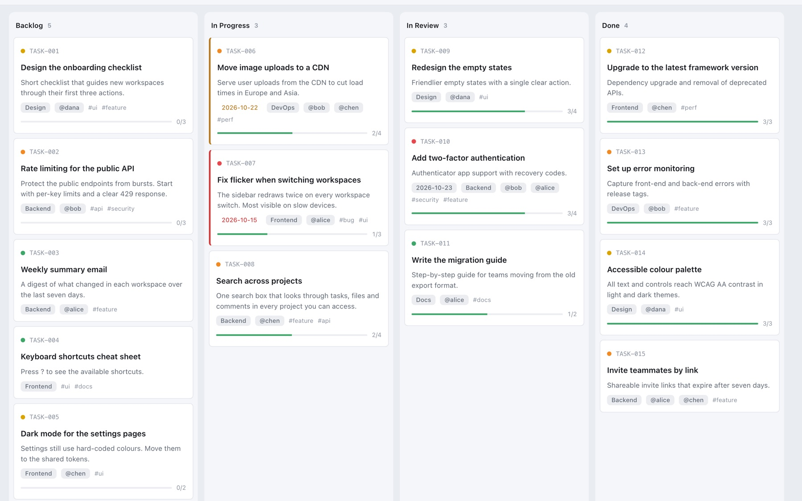

<p align="center"></p>

<h1 align="center">Kanban.md</h1>

<p align="center"><strong>A Kanban board that lives in plain Markdown files, shared by you in the browser and by AI agents on the command line.</strong></p>

<p align="center"><a href="https://ashikahmad.github.io/Kanban.md/app/">Open the app</a> · <a href="https://ashikahmad.github.io/Kanban.md/">Website</a> · <a href="./board/kanban.md">Project board</a> · <a href="./docs/getting-started.md">Docs</a></p>

> **[Version française](./readmeFR.md)** · Kanban.md began as a fork of [ioniks/MarkdownTaskManager](https://github.com/ioniks/MarkdownTaskManager) (MPL-2.0); see [About this fork](docs/about-this-fork.md).


*The board with the sample data from `docs/demo`.*

Kanban.md turns two Markdown files, `kanban.md` and `archive.md`, into an interactive board. The whole app is one HTML file that runs in your browser and reads and writes your folder directly. There is no server, no account and no database, and your tasks stay in files you can read, edit, diff and commit.

## What you get

- **Your tasks, as files.** Plain Markdown that works in any editor and displays properly in any Markdown viewer, including GitHub.
- **Fits in git.** Edits are small line-level patches, so moving a card changes one line and diffs stay readable.
- **A real board.** Drag-and-drop columns you define, subtasks with progress bars, priorities, tags, categories, assignees, due dates, search, filters, an archive, several projects, light and dark themes, and four interface languages.
- **Humans and AI at the same time.** A CLI and an MCP server let agents read and change the board safely while you use the browser. Changes show up on both sides within a couple of seconds, and concurrent edits are merged, not overwritten.
- **Cheap for AI.** An agent reads a few hundred tokens instead of the whole board. A "what is in this column?" question on a 100-task board costs about 1,000 tokens instead of about 20,000.
- **Private by construction.** Nothing leaves your machine. No telemetry, no CDN, works offline.
- **Scales up gently.** Housekeeping nudges, an optional separate backlog file, and optional manual card order keep big boards fast.
- **Shareable.** Copy a task as plain text or as a Markdown block another board can import.

## Where it shines

- Developers who want tasks next to their code, in the same repository and the same pull requests.
- Small teams who share a board through git.
- Anyone working with AI coding assistants who wants a clear, traceable record of what was asked and done.
- People who like owning their data and being able to open it in a text editor.

## What it is not for

- **Not a hosted service.** No accounts, permissions, notifications or live co-editing. Teams share a board through git or a synced folder.
- **Not a server or an API.** Agents use the CLI and the MCP server; there is no HTTP API.
- **Not for every browser.** It needs a Chromium-based desktop browser (Chrome, Edge, Opera, Brave). Firefox, Safari and iOS are not supported (they can still view a board from the web, read-only).
- **Not a reporting tool.** There are no charts or time tracking yet.

## Install and first run

1. Download [`kanbanmd.html`](kanbanmd.html).
2. Open it in Chrome, Edge, Opera or Brave.
3. Pick a folder. If it is empty, the app creates `kanban.md` and `archive.md` for you.

Want to look around first? Pick the [`docs/demo`](docs/demo) folder for a sample board with dummy tasks.

More options, including keeping the app in one shared place and using it across projects, are in [Getting started](docs/getting-started.md).

## Use it with AI agents

```bash
npm run mcp:install      # once, inside this repository
claude mcp add kanban -- node /path/to/Kanban.md/mcp/server.js --dir /path/to/your/project
```

The same operations are available from the shell as the `kanbanmd` CLI (`node cli/kanbanmd.js --dir . board --status in-progress`). Copy [`AI_WORKFLOW.md`](AI_WORKFLOW.md) into your project so your assistant knows the rules, and see [Working with AI agents](docs/ai-agents.md) for the tools, the per-assistant templates and the Claude Code skill.

## Documentation

| | |
|---|---|
| [Getting started](docs/getting-started.md) | Requirements, install options, where to put files, privacy |
| [Using the board](docs/using-the-board.md) | Tasks, filters, archive, projects, optional features |
| [Working with AI agents](docs/ai-agents.md) | MCP server, CLI, assistant setup, token costs |
| [File format](docs/file-format.md) | `kanban.md` and `archive.md`, configuration, migration |
| [Git and teams](docs/git-and-teams.md) | Sharing a board, conflicts, workflows |
| [Development](docs/development.md) | Build, test, code layout, contributing, how we run the project |
| [About this fork](docs/about-this-fork.md) | Where Kanban.md comes from and how it differs from the original |

## What's next

The project's own work is tracked on its own board: [`board/kanban.md`](board/kanban.md) shows what is done, in progress, planned, and what ideas we are weighing. You can also [view it in the app](https://ashikahmad.github.io/Kanban.md/app/?board=../board/kanban.md), read-only. Items tagged `#good-first-issue` and `#need-help` are good places to start if you'd like to contribute. Bugs and requests are welcome as GitHub issues.

## License and credit

Kanban.md is released under the [Mozilla Public License 2.0](LICENSE). It started as a fork of [ioniks/MarkdownTaskManager](https://github.com/ioniks/MarkdownTaskManager) and keeps its licence and copyright notices. Thanks to the original author and contributors, and to the File System Access API work in Chromium, on which the app relies.
