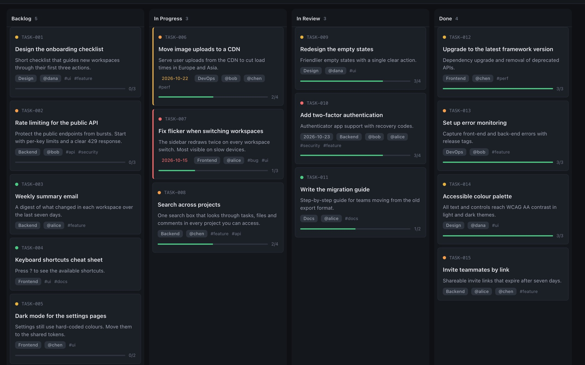
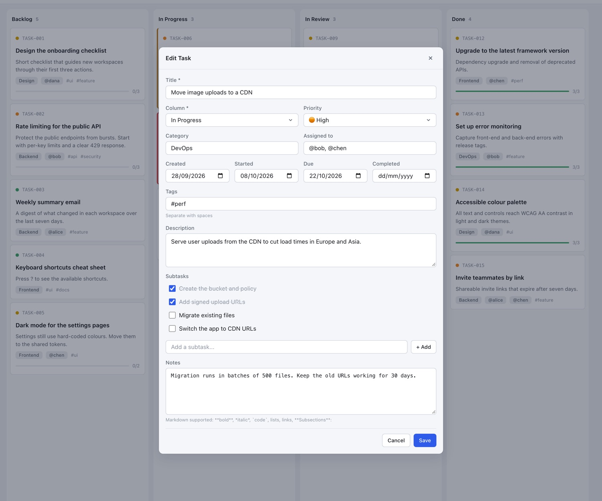
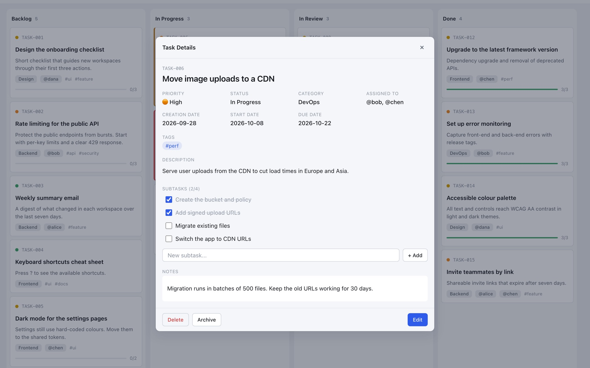
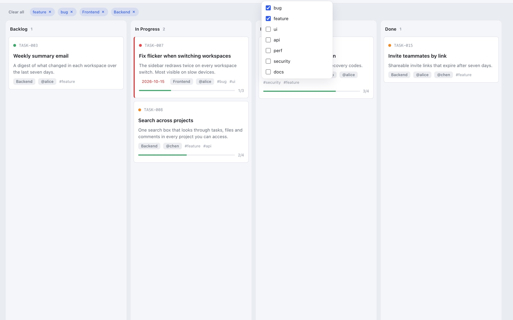
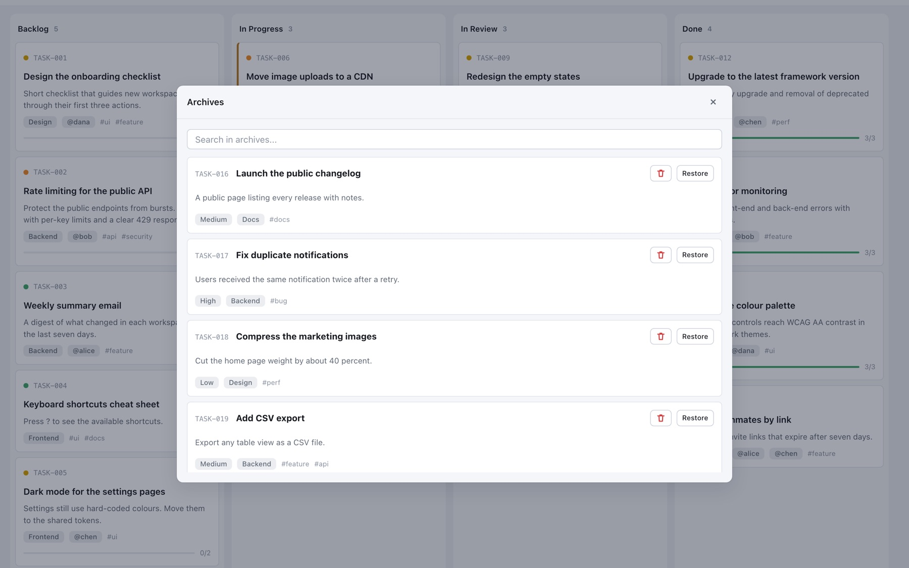
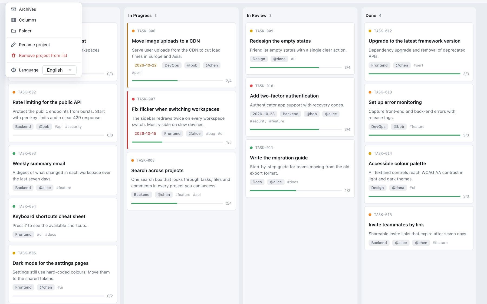

# Using the board

A tour of what the app does, in the order you will meet it.

*Dark theme, scrolled: the column titles stay in place and a hairline shows where cards pass underneath.*

## The board

- **Columns** are yours to define: the default is To Do, In Progress, Review and Done. Change them from the burger menu → **Columns**.
- **Drag and drop** moves a card between columns. On touch screens, drag works too, and each column has its own **+** button.
- **One scroller:** scroll anywhere and every column moves together. Column titles stay put.
- **Layout:** columns are at least 280px wide, share any extra space (up to 460px each), and the board scrolls sideways when they do not fit.
- **Counters** next to each title show how many tasks a column holds.
- **Cards** are compact: priority dot, ID, title, short description, category, assignees, tags, due date and a progress bar. The due date turns orange within two days of the deadline and red once overdue (finished tasks are never flagged). Click a tag, category, assignee or priority dot to filter. A pencil appears on hover to edit; click the card for its details.

## Tasks

*Creating or editing a task.*

Every task has an auto-generated ID (`TASK-042`) and a title. Everything else is optional:

- **Priority**: Critical, High, Medium or Low by default, and fully customizable (see [File format](file-format.md#priorities)).
- **Category**: one value from your own list.
- **Assigned**: one or more users (`@alice`, `@bob`).
- **Tags**: any number (`#bug`, `#feature`).
- **Dates**: created, started, due and finished.
- **Description**: free text with Markdown.
- **Subtasks**: add, edit, delete and tick off in place. A progress bar and a counter ("3/5 subtasks") show where you are.
- **Notes**: free-form text, often used to record the result of the work.

*Task details: metadata, tags, description, subtasks you can tick off, and notes.*

Every change is saved the moment you make it. There is no Save button.

## Search and filters

*Four filters beside the search box. Each button shows how many values are active; removable chips list them below.*

- **Search** is always visible in the top bar. It filters as you type, across titles, descriptions and notes, and it understands IDs (`TASK-042`).
- **Four filters**, each a checklist: Tags, Category, User and Priority.
- **Values within one filter are alternatives (OR).** Ticking `feature` and `bug` shows cards that have either.
- **Different filters combine (AND).** `feature or bug` **and** `Frontend or Backend`.
- Search and filters also combine: a card must match both.
- Active values show as chips under the toolbar. Remove one with ✕, or use **Clear all**.
- Under 1280px wide the four buttons collapse into one **Filters** button with a badge.
- Values from archived tasks stay available in the filters and autocomplete.

## Archive

*The archive: finished tasks, with search and restore.*

Archiving moves a task from `kanban.md` into `archive.md`. It is always a manual choice: nothing is archived on its own.

- Open it from the burger menu → **Archives**, and search it with its own search box.
- **Restore** puts a task back in its original column with its metadata intact.
- You can organise the archive in sections (by month or by sprint, for example).

## Several projects

*The project switcher, with custom names.*

The app remembers your last 10 project folders. Switch between them from the dropdown in the top bar. The last project reopens automatically, and you never need to pick the folder again (the browser may ask you to confirm access). Rename a project from the burger menu → **Rename project**.

## Live editing with other tools

The app picks up changes made outside it (an AI agent, the `kanbanmd` CLI, a text editor, `git pull`) within about two seconds. Your own edits are merged with theirs rather than overwriting them. If you have a task open in the edit form and it changed underneath you, the app asks before replacing it.

Because edits are written as minimal patches, changing one card touches only that card's lines. Git diffs stay small and readable.

## Viewing a board from the web

Add `?board=` and the address of a `kanban.md` to the app's address to open that board read-only. This project's own board, for example: [`app/?board=../board/kanban.md`](https://ashikahmad.github.io/Kanban.md/app/?board=../board/kanban.md).

- **Read-only.** You can browse, search, filter, open the archive and share a task. Nothing can be added, moved, edited or archived, and nothing is saved. A bar under the header shows where the board comes from; **Open a folder** there switches to one of your own projects.
- **The address** can be relative to the app (`../board/kanban.md`), a folder (`../board/` means the `kanban.md` in it), or a full `https://` address. A link to a file's page on github.com is turned into the raw file. `archive.md`, and the backlog file if the board names one, are read from the same folder when they exist.
- **Other sites ask first.** A board on the same site as the app opens at once. For a board on any other site, the app asks before downloading it, and contacts that site only if you agree. No cookies or referrer are sent.
- **The site has to allow it.** Browsers let a page read another site's files only when that site allows it (CORS). Raw GitHub files (`raw.githubusercontent.com`) and GitHub Pages do. Pages behind a sign-in do not.
- **Any browser.** Viewing needs no folder access, so it also works in Firefox and Safari.
- The board is downloaded once, when the page opens. Reload the page to see later changes.

## Optional features

**Manual card order.** By default a card sits wherever its block is in the file. The first time you drag a card to a specific spot, the app asks whether to remember the order. If you say yes, each task gets an `**Order**: 3000` line and every later move changes just two lines. Burger menu → **Manual order** turns it on or off, and **Reset order by task id** restores id order.

**Housekeeping nudges.** A quiet bar under the header suggests keeping the board small: tasks finished 30+ days ago (button: *Archive done*), backlog tasks older than 90 days, a board over 200 tasks, or a backlog over 100 tasks (button: *Move backlog to its own file*). *Snooze 7 days* hides it, *Dismiss* hides it until the numbers change. It never acts on its own. Change the numbers, or turn it off, in the burger menu → **Housekeeping**.

**Backlog file.** For a very large backlog, tasks in the backlog column can live in their own `backlog.md`, which keeps `kanban.md` small. The column becomes a stub with a count, and **Open backlog** shows a panel where you can search, send a task to any column, or archive it. Switch it on from the nudge or burger menu → **Backlog file**.

**Sharing a task.** The task details have a **Share** button. It shows a preview of exactly what would be shared (plain text for chat or mail, or the Markdown block that another board can import), with checkboxes to leave out notes and assignees, a **Copy** button, and **Share…** where your browser has a share sheet. The app sends nothing by itself.

## Appearance and language

- **Themes:** layered light and dark themes (the page, columns, cards and menus get lighter the closer they are to you). The theme icon at the right edge offers **Auto** (follows your system), **Light** and **Dark**.
- **Languages:** English, French, German and Simplified Chinese, from the burger menu. Some of the newest interface text is only translated into English and French so far, and falls back to English in the others. The content of your Markdown files stays in whatever language you wrote it.
- **Keyboard:** **Esc** closes menus and dialogs.

## The top bar

- **☰ Burger menu** (left): Archives, Columns, Folder, Rename project, Remove project from list, Language, and the optional features above.
- **Project switcher**, **search** and **filters**.
- **+ Task** creates a task.
- **◐ Theme** (right).
