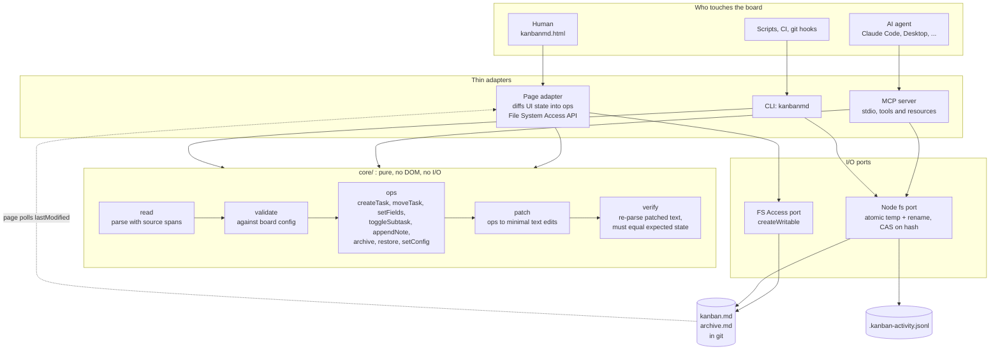
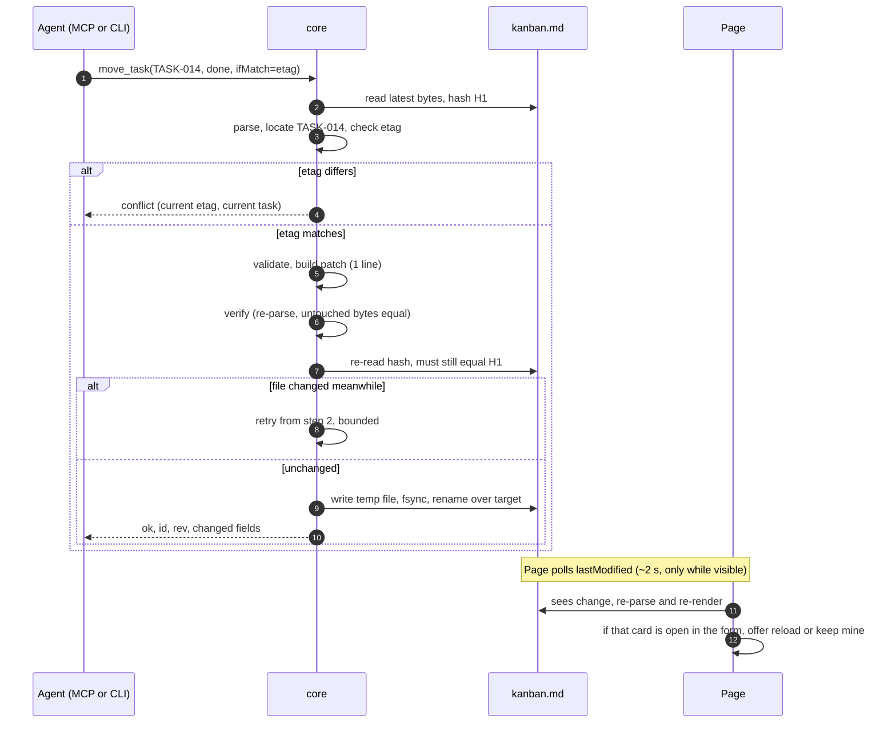
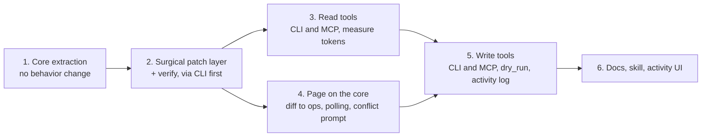

# Diagrams: shared core, surgical edits, MCP

Companion to [mcp-file-plan.md](mcp-file-plan.md). Each diagram is a fenced `mermaid` block, so any Markdown viewer with Mermaid support renders it.

## Architecture

Who touches the board, the thin adapters, the shared core and the files. Referenced from section 4 of the plan.

## Write protocol

One agent write end to end, including the conflict and retry paths, and the page picking up the change. Referenced from section 6.

## Phase order

Dependencies between the build phases. Referenced from section 10.

